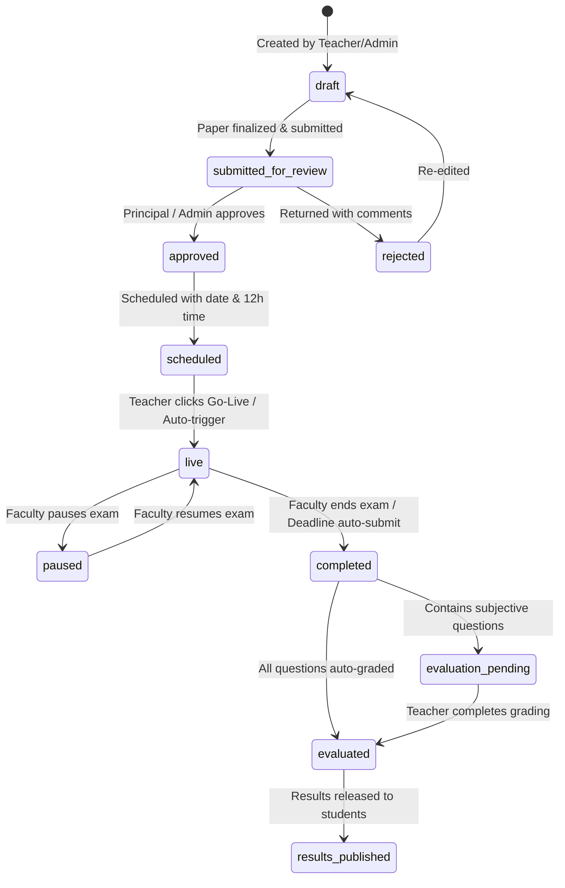
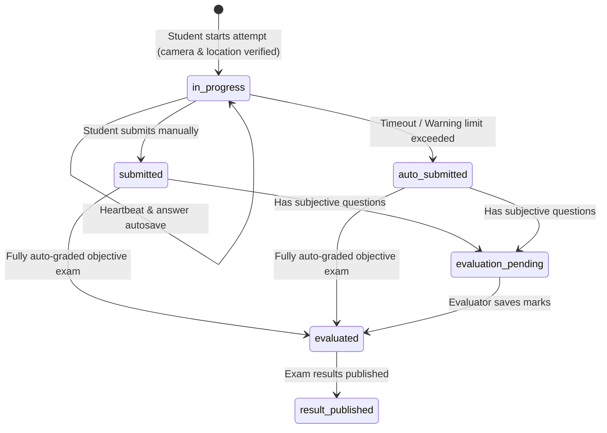

# System Architecture: School Management ERP (Online Examination Subsystem)

## 1. Directory & Folder Map

```
School-Management-ERP/
├── BACKEND/
│   ├── .env                       # Environment configuration
│   ├── package.json               # Backend dependencies & vitest scripts
│   ├── vitest.config.js           # Vitest test runner configuration
│   ├── src/
│   │   ├── app.js                 # Express application setup, security middleware, routing
│   │   ├── server.js              # HTTP server & Socket.IO initialization
│   │   ├── socket.js              # Centralized Socket.IO instance and emitters
│   │   ├── seed.js                # Database seeder (Demo users, exams, categories)
│   │   ├── config/
│   │   │   ├── db.js              # Mongoose DB connection (supports test DB naming)
│   │   │   ├── cloudinary.js      # Cloudinary media storage client
│   │   │   └── defaultAssessmentTemplates.js
│   │   ├── controllers/
│   │   │   ├── academicController.js      # Academic structure (classes, subjects)
│   │   │   ├── analyticsController.js     # Admin & Student performance analytics
│   │   │   ├── authController.js          # Authentication, User management, Directories
│   │   │   ├── categoryController.js      # 4-level taxonomy (Unit, Topic, Subtopic, Child)
│   │   │   ├── dashboardController.js     # Role dashboards (Admin, Teacher, Student)
│   │   │   ├── examController.js          # Exam lifecycle, attempt engine, anti-cheat, evaluation
│   │   │   ├── examPatternController.js   # Question blueprints & assessment templates
│   │   │   ├── notificationController.js  # Notifications, unread counts, mark read
│   │   │   ├── pdfReportController.js     # PDF generation (Mark sheet, Student report)
│   │   │   ├── questionController.js      # Question bank CRUD, bulk imports
│   │   │   ├── questionPaperController.js # Standalone Question Paper preparation
│   │   │   └── topicAnalysisController.js # Deep topic mastery analytics
│   │   ├── middlewares/
│   │   │   ├── authMiddleware.js          # JWT verification & role-based access control
│   │   │   └── errorHandler.js            # Centralized API error response handler
│   │   ├── models/
│   │   │   ├── academicModel.js           # AcademicStructure
│   │   │   ├── assessmentTemplateModel.js # AssessmentTemplate
│   │   │   ├── attemptAnswerModel.js      # AttemptAnswer
│   │   │   ├── categoryModel.js           # Category (4-level taxonomy)
│   │   │   ├── examinationAttemptModel.js # ExaminationAttempt
│   │   │   ├── examinationAuditLogModel.js# ExaminationAuditLog
│   │   │   ├── examinationModel.js        # Examination
│   │   │   ├── examPatternModel.js        # ExamPattern
│   │   │   ├── notificationModel.js       # Notification
│   │   │   ├── paperVersionModel.js       # PaperVersion
│   │   │   ├── proctoringMediaModel.js    # ProctoringMedia
│   │   │   ├── questionModel.js           # Question
│   │   │   ├── questionPaperModel.js      # QuestionPaper
│   │   │   ├── userModel.js               # User
│   │   │   └── violationLogModel.js       # ViolationLog
│   │   ├── routes/
│   │   │   ├── academicRoutes.js
│   │   │   ├── authRoutes.js
│   │   │   ├── categoryRoutes.js
│   │   │   ├── dashboardRoutes.js
│   │   │   ├── examPatternRoutes.js
│   │   │   ├── examRoutes.js
│   │   │   ├── notificationRoutes.js
│   │   │   ├── questionPaperRoutes.js
│   │   │   ├── questionRoutes.js
│   │   │   └── uploadRoutes.js
│   │   ├── services/
│   │   │   ├── examEngineService.js       # Scoring and grading evaluation
│   │   │   ├── examSchedulerService.js    # Cron-based auto-golive & auto-completion
│   │   │   ├── liveMonitorService.js      # Roster aggregation & active candidate status
│   │   │   ├── notificationService.js     # Centralized notification creation & dispatch
│   │   │   ├── paperValidationService.js  # Marks & blueprint integrity checking
│   │   │   └── questionBankService.js     # Question search & duplication detection
│   │   └── utils/
│   │       └── timeUtils.js               # 12-hour AM/PM formatting & Asia/Kolkata timezone utils
│   └── tests/                             # Vitest backend integration test suites
├── FRONTEND/
│   ├── .env                               # Vite frontend environment variables
│   ├── package.json                       # React 19, Bootstrap 5, Lucide-react
│   ├── vite.config.js                     # Vite build & Vitest test config
│   ├── src/
│   │   ├── App.jsx                        # Route definitions & ProtectedRoute wrappers
│   │   ├── main.jsx                       # Entrypoint
│   │   ├── api/
│   │   │   ├── api.js                     # Axios instance export
│   │   │   └── socket.js                  # Socket.IO client instance
│   │   ├── components/
│   │   │   ├── CameraProctor.jsx          # Live camera feed, border guide, face detector
│   │   │   ├── CascadingCategorySelector.jsx # 4-level category dropdown selector
│   │   │   ├── ExamErrorBoundary.jsx      # Error boundary with recovery
│   │   │   ├── NotificationBell.jsx       # Real-time bell icon with unread count
│   │   │   ├── ProtectedRoute.jsx         # Role-based route guard
│   │   │   ├── RoughWorkPanel.jsx         # Draggable notes & drawing canvas
│   │   │   ├── SafeCalculator.jsx         # Token-free math parser calculator
│   │   │   ├── Sidebar.jsx                # Responsive navigation sidebar
│   │   │   └── TimePicker.jsx             # 12-hour AM/PM custom selector
│   │   ├── pages/
│   │   │   ├── auth/Login.jsx             # User login
│   │   │   ├── dashboard/Dashboard.jsx    # Portal landing by role
│   │   │   ├── exams/
│   │   │   │   ├── CreateExamWizard.jsx   # 4-step wizard to schedule & select question paper
│   │   │   │   ├── ExamApproval.jsx       # Admin review & approve workflow
│   │   │   │   ├── ExamList.jsx           # Exam schedule hub
│   │   │   │   ├── ExamPatterns.jsx       # Blueprint configuration
│   │   │   │   ├── ExamResultsDashboard.jsx # Analytics and cohort performance
│   │   │   │   ├── LiveExamMonitor.jsx    # Real-time proctoring & candidate roster
│   │   │   │   ├── LiveExamsSection.jsx   # Live exam cards for students and faculty
│   │   │   │   ├── QuestionBank.jsx       # Legacy question bank view (to be phased out)
│   │   │   │   ├── QuestionPaperBuilder.jsx # Question creation & section designer
│   │   │   │   ├── QuestionPaperList.jsx  # Question paper library
│   │   │   │   ├── StudentExamInterface.jsx # Student exam taker UI
│   │   │   │   ├── StudentReport.jsx      # Student progress report
│   │   │   │   ├── StudentResultView.jsx  # Student exam scorecard
│   │   │   │   └── TeacherEvaluation.jsx  # Subjective answer grading
│   │   │   ├── notifications/
│   │   │   │   └── NotificationPage.jsx   # Notification center
│   │   │   ├── students/                  # Student directory views
│   │   │   └── teachers/                  # Teacher directory views
│   │   ├── services/                      # Axios HTTP client service layer
│   │   └── utils/
│   │       ├── faceDetector.js            # Video luminance/variance face analyzer
│   │       ├── mathEvaluator.js           # AST-based safe math expression evaluator
│   │       └── timeUtils.js               # 12-hour AM/PM time helpers
```

---

## 2. Models & Fields

| Model | Collection | Key Fields | Indexes |
|---|---|---|---|
| **User** | `users` | `name`, `email`, `password`, `role` (`superadmin`, `admin`, `teacher`, `student`, `principal`), `schoolId`, `profilePhoto`, `photoPublicId`, `studentProfile` (`classGrade`, `section`, `rollNumber`), `teacherProfile` (`assignedClasses`, `assignedSubjects`) | `email: 1` (unique), `schoolId: 1` |
| **Examination** | `examinations` | `title`, `examCode`, `category`, `classGrade`, `sections`, `subject`, `createdBy`, `questionPaperId`, `status` (`draft`, `submitted_for_review`, `approved`, `scheduled`, `live`, `paused`, `completed`, `results_published`, etc.), `examDate`, `startTime`, `endTime`, `durationMinutes`, `totalMarks`, `passingMarks`, `examSections` (array of sections with embedded questions), `tabSwitchLimit`, `facePauseRule`, `maxFacePauseMinutes`, `isSnapshotLocked` | `examCode: 1` (unique), `classGrade: 1`, `subject: 1`, `status: 1` |
| **ExaminationAttempt** | `examinationattempts` | `student`, `examination`, `attemptNumber`, `startedAt`, `submittedAt`, `deadline`, `status` (`in_progress`, `submitted`, `auto_submitted`, `evaluation_pending`, `evaluated`, `result_published`), `submissionType`, `answers` (array of `questionId`, `studentAnswer`, `marksAwarded`, `isEvaluated`), `score` (`totalScore`, `maxMarks`, `percentage`, `isPassed`), `tabSwitchesCount`, `totalFacePauseMs`, `faceViolationCount`, `location` (`latitude`, `longitude`, `accuracy`), `lastHeartbeatAt` | `{ student: 1, examination: 1, attemptNumber: 1 }` (unique) |
| **QuestionPaper** | `questionpapers` | `title`, `classGrade`, `subject`, `totalMarks`, `passingMarks`, `durationMinutes`, `sections`, `status` (`draft`, `ready`, `in_use`), `createdBy`, `isArchived` | `{ createdBy: 1, isArchived: 1, classGrade: 1, subject: 1 }` |
| **Question** | `questions` | `questionText`, `questionType`, `subject`, `classGrade`, `unitId`, `topicId`, `subTopicId`, `childTopicId`, `chapter`, `topic`, `difficulty`, `marks`, `negativeMarks`, `options`, `correctAnswer`, `explanation`, `createdBy` | `{ subject: 1, classGrade: 1, unitId: 1, topicId: 1 }` |
| **Category** | `categories` | `name`, `level` (`unit`, `topic`, `subtopic`, `child`), `parentId`, `path` (array of ancestor refs), `subject`, `classGrade`, `isDeleted` | `{ subject: 1, classGrade: 1, parentId: 1, isDeleted: 1 }`, `name: "text"` |
| **ExamPattern** | `exampatterns` | `name`, `patternCode`, `classGrade`, `subject`, `totalMarks`, `durationMinutes`, `sections`, `status`, `assignedTeachers` | `patternCode: 1` (unique) |
| **Notification** | `notifications` | `recipient`, `examination`, `type`, `title`, `message`, `link`, `isRead`, `examMetadata` | `{ recipient: 1, isRead: 1, createdAt: -1 }`, `{ examination: 1, recipient: 1, type: 1 }` |
| **ProctoringMedia** | `proctoringmedia` | `examination`, `attempt`, `student`, `mediaType` (`snapshot`, `video_chunk`), `mediaUrl`, `publicId`, `timestamp`, `fileSize` | `{ examination: 1, attempt: 1, timestamp: -1 }` |
| **ViolationLog** | `violationlogs` | `examination`, `attempt`, `student`, `violationType`, `description`, `timestamp`, `severity` | `{ attempt: 1, timestamp: -1 }`, `{ examination: 1, timestamp: -1 }` |
| **ExaminationAuditLog** | `examinationauditlogs` | `examinationId`, `userId`, `userRole`, `action`, `metadata`, `timestamp` | `{ examinationId: 1, timestamp: -1 }` |
| **AcademicStructure** | `academicstructures` | `academicYear`, `classes` (array of `name`, `code`, `level`, `sections`, `subjects`), `isDefault` | None |

---

## 3. Backend Routes Matrix

| Method | Route Path | Allowed Roles | Controller & Function |
|---|---|---|---|
| POST | `/api/auth/login` | Public | `authController.login` |
| POST | `/api/auth/setup-superadmin` | Public | `authController.setupSuperAdmin` |
| GET | `/api/auth/me` | Authenticated | `authController.getCurrentUser` |
| GET | `/api/auth/teachers` | Admin, Teacher | `authController.getTeachers` |
| POST | `/api/auth/teachers` | Admin | `authController.createTeacher` |
| GET | `/api/auth/students` | Admin, Teacher | `authController.getStudents` |
| POST | `/api/auth/students` | Admin, Teacher | `authController.createStudent` |
| GET | `/api/academic` | Authenticated | `academicController.getAcademicStructure` |
| PUT | `/api/academic` | Superadmin, Admin | `academicController.updateAcademicStructure` |
| GET | `/api/categories/cascading` | Authenticated | `categoryController.getCascadingCategories` |
| GET | `/api/categories/search` | Authenticated | `categoryController.searchCategories` |
| POST | `/api/categories` | Admin, Teacher | `categoryController.createCategory` |
| PUT | `/api/categories/:id` | Admin, Teacher | `categoryController.updateCategory` |
| DELETE | `/api/categories/:id` | Admin, Teacher | `categoryController.deleteCategory` |
| GET | `/api/exams` | Authenticated | `examController.getExams` |
| POST | `/api/exams` | Admin, Teacher | `examController.createExam` |
| GET | `/api/exams/:id` | Authenticated | `examController.getExamById` |
| PUT | `/api/exams/:id` | Admin, Teacher | `examController.updateExam` |
| PUT | `/api/exams/:id/paper` | Admin, Teacher | `examController.updateQuestionPaper` |
| PUT | `/api/exams/:id/submit-review` | Admin, Teacher | `examController.submitForReview` |
| PUT | `/api/exams/:id/review` | Superadmin, Admin | `examController.reviewExam` |
| PUT | `/api/exams/:id/schedule` | Admin, Teacher | `examController.scheduleExam` |
| PUT | `/api/exams/:id/publish` | Admin, Teacher | `examController.publishExam` |
| PUT | `/api/exams/:id/cancel` | Admin, Teacher | `examController.cancelExam` |
| POST | `/api/exams/:id/go-live` | Admin, Teacher | `examController.goLiveExam` |
| POST | `/api/exams/:id/pause` | Admin, Teacher | `examController.pauseExam` |
| POST | `/api/exams/:id/resume` | Admin, Teacher | `examController.resumeExam` |
| POST | `/api/exams/:id/end` | Admin, Teacher | `examController.endExam` |
| POST | `/api/exams/:id/start-attempt` | Student | `examController.startExamAttempt` |
| POST | `/api/exams/attempts/:attemptId/heartbeat` | Authenticated | `examController.attemptHeartbeat` |
| POST | `/api/exams/attempts/:attemptId/violation` | Authenticated | `examController.logAttemptViolation` |
| PUT | `/api/exams/attempts/:attemptId/answers/:questionId` | Authenticated | `examController.saveAttemptAnswerDirect` |
| POST | `/api/exams/attempts/:attemptId/submit` | Authenticated | `examController.submitExamAttempt` |
| GET | `/api/exams/attempts/:attemptId/mark-sheet/pdf` | Authenticated | `pdfReportController.downloadExamMarkSheetPdf` |
| GET | `/api/exams/:examId/monitor` | Admin, Teacher | `examController.getExamMonitor` |
| GET | `/api/exams/:examId/submissions` | Admin, Teacher | `examController.getExamSubmissions` |
| GET | `/api/exams/attempt/:attemptId` | Admin, Teacher | `examController.getAttemptForEvaluation` |
| POST | `/api/exams/attempt/:attemptId/evaluate` | Admin, Teacher | `examController.saveManualEvaluation` |
| POST | `/api/exams/:examId/publish-results` | Admin, Teacher | `examController.togglePublishResults` |
| GET | `/api/exams/:examId/analytics` | Admin, Teacher | `examController.getExamAnalytics` |
| GET | `/api/exams/:examId/results` | Authenticated | `examController.getStudentResult` |
| GET | `/api/question-papers` | Admin, Teacher | `questionPaperController.getQuestionPapers` |
| POST | `/api/question-papers` | Admin, Teacher | `questionPaperController.createQuestionPaper` |
| GET | `/api/question-papers/:id` | Admin, Teacher | `questionPaperController.getQuestionPaperById` |
| PUT | `/api/question-papers/:id` | Admin, Teacher | `questionPaperController.updateQuestionPaper` |
| POST | `/api/question-papers/:id/duplicate` | Admin, Teacher | `questionPaperController.duplicateQuestionPaper` |
| DELETE | `/api/question-papers/:id` | Admin, Teacher | `questionPaperController.deleteQuestionPaper` |
| GET | `/api/dashboard/admin/analytics` | Superadmin, Admin | `analyticsController.getAdminAnalyticsReport` |
| GET | `/api/dashboard/student/report` | Student | `analyticsController.getStudentPerformanceReport` |
| GET | `/api/dashboard/student/report/pdf` | Student, Admin | `pdfReportController.downloadStudentReportPdf` |
| GET | `/api/dashboard/topic-analysis` | Authenticated | `topicAnalysisController.getChapterTopicAnalysis` |
| GET | `/api/notifications` | Authenticated | `notificationController.getMyNotifications` |
| GET | `/api/notifications/unread-count` | Authenticated | `notificationController.getUnreadCount` |
| PUT | `/api/notifications/:id/read` | Authenticated | `notificationController.markAsRead` |
| PUT | `/api/notifications/mark-all-read` | Authenticated | `notificationController.markAllAsRead` |
| POST | `/api/upload/proctoring/snapshot` | Student | `uploadRoutes` (Cloudinary) |
| POST | `/api/upload/proctoring/chunk` | Student | `uploadRoutes` (Cloudinary) |

---

## 4. Frontend Routes & Pages Map

| Route Path | Component | Protected Roles | Purpose |
|---|---|---|---|
| `/login` | `Login.jsx` | Public | Auth entry point |
| `/dashboard` | `Dashboard.jsx` | All authenticated | Role-tailored dashboards |
| `/exams` | `ExamList.jsx` | All authenticated | Exam schedule hub and list |
| `/exams/live` | `LiveExamsSection.jsx` | All authenticated | Dedicated active and live exams portal |
| `/exams/create` | `CreateExamWizard.jsx` | Admin, Teacher | Exam scheduling & paper selection wizard |
| `/exams/:id/builder` | `QuestionPaperBuilder.jsx` | Admin, Teacher | Question authoring canvas |
| `/question-papers` | `QuestionPaperList.jsx` | Admin, Teacher | Master question paper management |
| `/exam-patterns` | `ExamPatterns.jsx` | Admin, Teacher | Exam blueprints |
| `/exams/approvals` | `ExamApproval.jsx` | Superadmin, Admin | Review, approve or reject exam papers |
| `/exams/:id/monitor` | `LiveExamMonitor.jsx` | Admin, Teacher | Live candidate monitoring dashboard |
| `/exams/:id/take` | `StudentExamInterface.jsx`| Student | Live exam interface with camera & timer |
| `/exams/evaluations` | `TeacherEvaluation.jsx` | Admin, Teacher | Manual descriptive grading |
| `/exams/results` | `ExamResultsDashboard.jsx` | All authenticated | Exam cohort results & statistics |
| `/exams/:id/results` | `StudentResultView.jsx` | All authenticated | Individual candidate scorecard |
| `/reports/my-report` | `StudentReport.jsx` | Student | Comprehensive longitudinal analytics report |
| `/notifications` | `NotificationPage.jsx` | All authenticated | Notifications inbox |
| `/question-bank` | `QuestionBank.jsx` | Admin, Teacher | *Legacy route scheduled for removal* |

---

## 5. Services Layer Architecture

* **Frontend Services (`FRONTEND/src/services/`):**
  - `api.js`: Unified Axios instance with request/response interceptors injecting JWT tokens and intercepting 401s.
  - `examService.js`, `attemptService.js`, `categoryService.js`, `questionPaperService.js`, `liveService.js`, `notificationService.js`, `analyticsService.js`, `resultService.js`.
* **Backend Services (`BACKEND/src/services/`):**
  - `examSchedulerService.js`: Recurring job (every 30s) running state transitions for scheduled exams reaching start/end windows.
  - `liveMonitorService.js`: Builds aggregated roster merging eligible candidates with attempt records, status, and ping age.
  - `notificationService.js`: Encapsulates central notification creation and dispatches real-time Socket.IO events.
  - `paperValidationService.js`: Validates sections, totals, and marks allocation.
  - `examEngineService.js`: Executes automatic evaluations for objective question types.

---

## 6. Real-Time Architecture

* **Transport**: Socket.IO (`v4.8.4`).
* **Rooms & Channels**:
  - `user_${userId}`: Direct personal notifications (schedule changes, go-live alerts, results published).
  - `exam_monitor_${examId}`: Real-time candidate roster updates, heartbeat pings, and proctoring warnings broadcasted to faculty.
* **Fallback / Redundancy**:
  - Foreground polling intervals (e.g. 6s-10s) on monitor screens with automatic pause on tab blur/visibility change.
  - No WebRTC/LiveKit media streaming server is deployed; proctoring operates via client-side face boundary evaluation and periodic snapshot uploads directly to Cloudinary via multipart memory streaming.

---

## 7. Environment Variables Reference

| Variable | Location | Purpose | Required / Default |
|---|---|---|---|
| `PORT` | Backend | HTTP listen port | Default: `5000` |
| `MONGO_URI` | Backend | MongoDB Atlas connection string | Required |
| `JWT_SECRET` | Backend | Secret key for signing authentication tokens | Required |
| `JWT_EXPIRES_IN`| Backend | Token expiration duration | Default: `7d` |
| `CLOUDINARY_CLOUD_NAME` | Backend | Cloudinary cloud account name | Required for media |
| `CLOUDINARY_API_KEY` | Backend | Cloudinary API Key | Required for media |
| `CLOUDINARY_API_SECRET` | Backend | Cloudinary API Secret | Required for media |
| `FRONTEND_URL` | Backend | CORS origin whitelist | Default: `http://localhost:5173` |
| `VITE_API_BASE_URL` | Frontend | Base URL for backend REST API | `http://localhost:5000/api` |
| `VITE_SOCKET_URL` | Frontend | Base URL for Socket.IO connection | Default fallback: `http://localhost:5000` |

---

## 8. Exam Status & Attempt Status Lifecycle Flows

### Examination Status State Machine


### Examination Attempt State Machine

